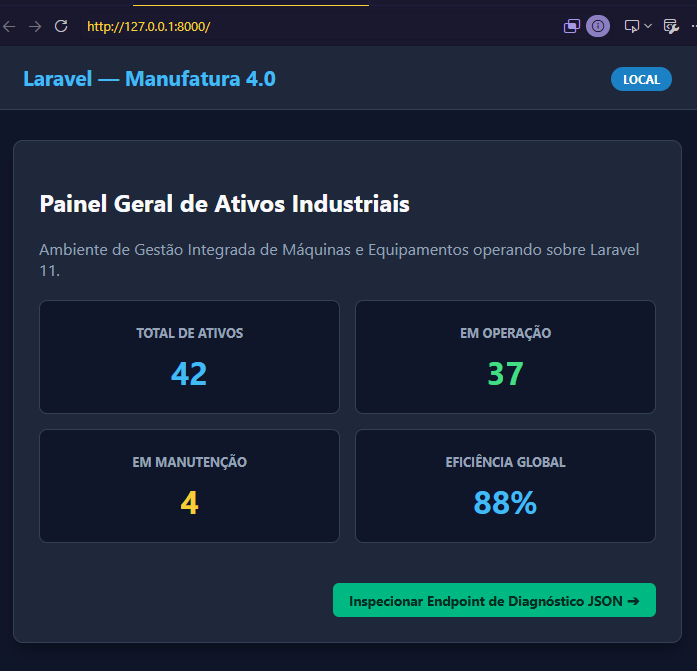
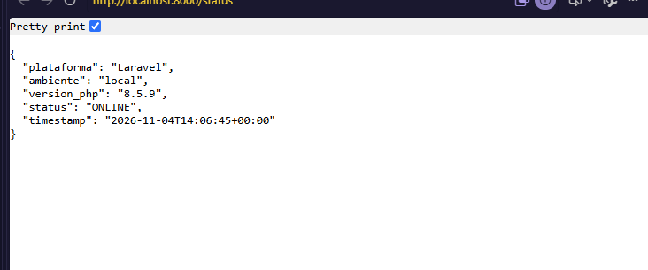
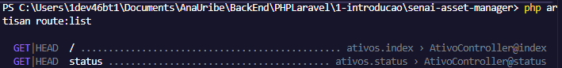
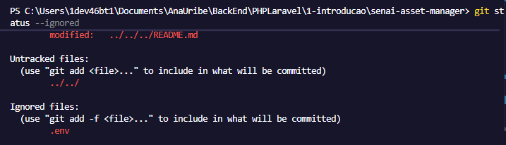
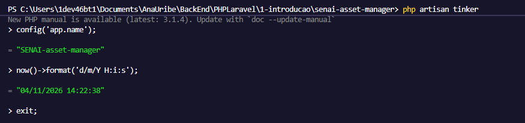
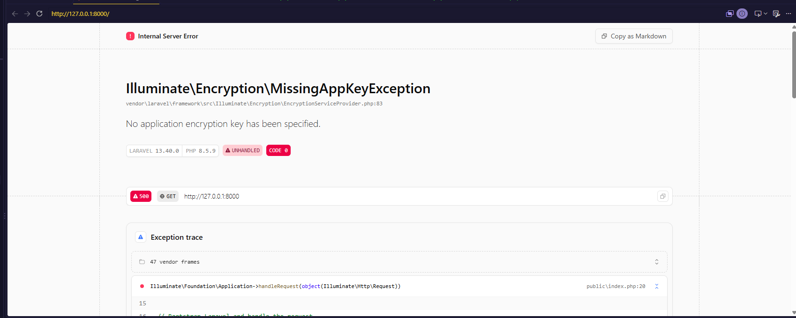
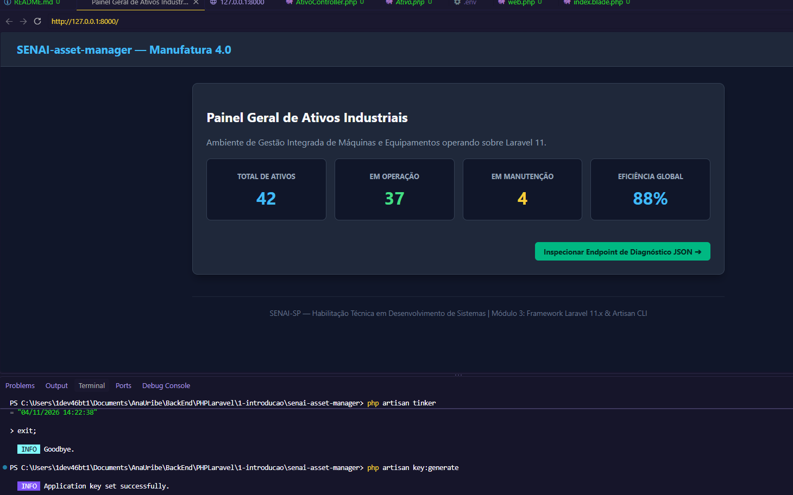

# Meu Primeiro Projeto Laravel - SENAI Asset Manager (Sistema de gestão de ativos Industriais e Maquinários)

## 1. Criação da Aplicação laravel

Abrir o terminal do VS code na Pasta qeu deseja adicionar o projeto

```bash

php --version       #verifica a versão php

composer --version  # verifica a versão do Composer

#cria o projeto dentro da passta
composer create-project laravel/laravel nome-do-projeto

#acessar a pasta criada
cd nome-do-projeto
```


## 2. Configurar o arquvio de blidagem `.env`

Abrir o arquivo e configurar os parâmetros 

configurr as informações das variáveis de Ambiente para o projeto

e inserir a chave de criptografia caso não tenha

```bash
php artisan key:generate
```

## 3. Inspecionar e Homologar a aplicação com `php artisan about`

Inspecionar
`php artisan about`

Homologar 
`php artisan serve`

## Criação dos Models

Geral o Model para Representar as Máquinas/Equipamentos do Sistema

Criar uma Classe Chamada Ativo

`php artisan make:Model Ativo`

preencher com as informações da tabela 

$table => refere-se ao nome da tabela no banco de dados

$fillable => refere-se as colunas(atributos) que serão adicionadas a tabela

## 4. Criação do Controller

`php artisan make:controller AtivoController`

app/Http/Controller/AtivoController.php

criação de dois métodos 

um para listar o status da maquinas com dados mokados
um para listar em um json as informações do servidor

## 5. Criação das Rotas de Navegação

`routes/web.php`
criação de duas rotas do tipo get

uma de ativos mokados, 
uma de status da infra

## 6. Camada de Visualização `Blade`

`resources/views/`

criar a pasta ativos
 e criar o arquivo blade

- blade é a engine de visualização do laravel, que permite criar páginas web dinâmicas com sintaxe simples e elegante
- databind no blade é feito com a sintaxe `{{ $variável }}`
- databind é o processo de vincular dados do backend (controlador ou modelo) a elementos da interface do usuário (UI). 
- twoway databind é o processo de vincular dados entre o backend e a interface do usuário de forma bidirecional, permitindo que as alterações em um lado sejam refletidas no outro.

## 7. Roteiro de Homologação e Teste


Execute a sequência de 7 testes de validação técnica no laboratório:

1. **Teste 1 — Servidor HTTP Ativo:**  
   Inicie o servidor com `php artisan serve` e acesse `http://localhost:8000/`.  
   *Resultado Esperado:* A página corporativa do *SENAI Asset Manager* é renderizada perfeitamente, exibindo os 4 cards de métricas (42 ativos, 37 em operação, 4 em manutenção e 88.5% de eficiência).

   

2. **Teste 2 — Resposta da Rota de Diagnóstico JSON:**  
   Acesse a URL `http://localhost:8000/status` (ou clique no botão verde do painel).  
   *Resultado Esperado:* O navegador exibe a resposta estruturada em JSON semântico:
   ```json
   {
       "plataforma": "SENAI Asset Manager",
       "ambiente": "local",
       "versao_php": "8.3.x",
       "status": "ONLINE",
       "timestamp": "2026-10-30T16:45:00-03:00"
   }
   ```
   

3. **Teste 3 — Inspeção de Rotas com Artisan:**  
   No terminal, execute `php artisan route:list`.  
   *Resultado Esperado:* As rotas `ativos.index` e `ativos.status` aparecem associadas às ações do `AtivoController`.

   

4. **Teste 4 — Auditoria de Blindagem do Arquivo `.env`:**  
   Abra o terminal e verifique se o `.env` está protegido pelo Git:
   ```bash
   git status --ignored
   ```
   *Resultado Esperado:* O arquivo `.env` aparece listado na seção de arquivos ignorados (`Ignored files`). Ele **nunca** deve aparecer como arquivo rastreado (*Untracked/Staged*)!



5. **Teste 5 — Teste de Execução no Terminal Interativo (Tinker):**  
   Abra o REPL do Laravel:
   ```bash
   php artisan tinker
   ```
   Digite os seguintes comandos dentro do Tinker:
   ```php
   config('app.name');
   // Retorna: "SENAI Asset Manager"
   
   now()->format('d/m/Y H:i:s');
   // Retorna a data e hora atual no fuso configurado
   
   exit;
   ```
  

6. **Teste 6 — Auditoria da Chave Criptográfica:**  
   Experimente apagar temporariamente o valor da `APP_KEY` no `.env` e recarregue a página no navegador.  
   *Resultado Esperado:* O Laravel bloqueia a execução e exibe a mensagem de segurança alertando sobre a ausência da chave de criptografia.  
   *Restauração:* Execute `php artisan key:generate` para restabelecer a segurança e recarregue a página.
   
   
   

7. **Teste 7 — Verificação do Painel de Saúde (`php artisan about`):**  
   Execute `php artisan about` no terminal.  
   *Resultado Esperado:* Todos os indicadores técnicos devem estar validados em verde.

# Continuando a aplicação - Criação do módulo gerenciameno de clientes

## Criação do Model e Migração do Banco de Dados

Criar o arquivo de migração e o model com o comando
`php artisan make:model Cliente -m`

obs: ao usar a flag -m o Laravel cria 2 arquivos, o Model e o Migration

- Um arquivo no `database/migration` -> inserir a tabela no banco
- Um arquivo no `app/Model` - gerenciador do modelo de relacional

comando para automação do banco 
`php artisan migrate`

## Criar o controller de recurso para a entidade Cliente

Executar o comando 

`php artisan make:controller Cliente Controller --resource`

>obs: ao usarflag --resource são criados 7 métodos automaticamente dentro do controller

- um arquivo é criado em `app/http/controllers/ClienteController.php`

contendo os 7 métodos de assinatura de resource

## Criar as rotas Nomeadas para os Controllers dentro do Arquivo (`routes/web.php`)

Depois de criar o Model, executar a migração e implementar o controller, vamos declarar as rotas do módulo em `routes/web.php`

Uso do elemento Resource para gerar todas as rotas do controller

`Route::resource()` => gera todas as rotas do controller

## Contrução das Views Blade

Criar o diretório `resources/views/clientes`=>
criar os arquivos dentro da platas `/clientes`

index.blade.php
show.blade.php
create.blade.php
edit.blade.php